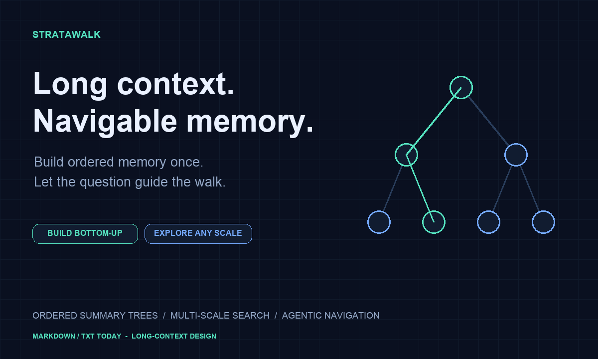
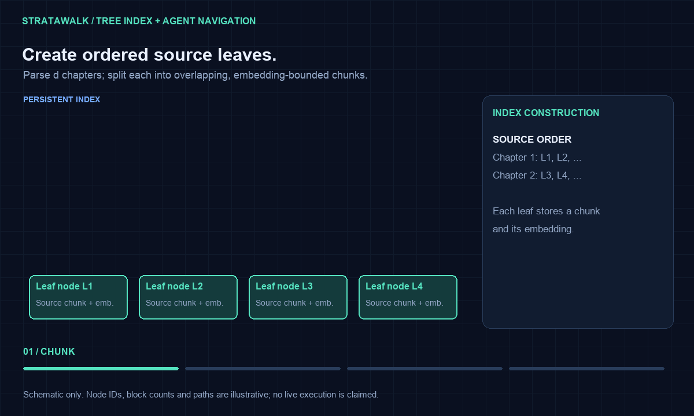
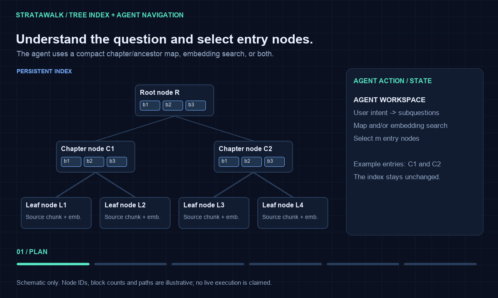

<div align="center">



### Hierarchical memory for long-document agents

**Zoom out for perspective. Zoom in for evidence.**

[Quick Start](#quick-start) · [Watch the Walk](#watch-the-walk) · [How It Works](#how-it-works) · [Architecture](docs/architecture.md) · [Roadmap](#roadmap)

<sub>🚧 Early implementation · Offline demo available · Benchmarks forthcoming</sub>

</div>

---

A passage tells you **what happened**. A chapter explains **why**.
The whole document reveals **how the argument fits together**.

**StrataWalk gives agents a way to move between these scales.**
It builds an ordered hierarchy from source passages to a document overview,
then lets an agent search, explore, and return to the original evidence.

## Quick Start

Run the offline example with Python 3.9+; no API key or runtime dependencies:

```bash
git clone https://github.com/zhipuch/StrataWalk.git
cd StrataWalk
PYTHONPATH=src python3 examples/offline_demo.py
```

The example builds a persisted tree, searches source passages, and prints
source references. Its extractive summaries, hashed lexical vectors, and
scripted policy are development fixtures—not quality benchmarks.

**Use a real LLM:** [Model setup and CLI commands](docs/usage.md) ·
**Explore the implementation:** [Code map and extension points](docs/development.md) ·
[Algorithm and engineering review](docs/implementation-review.md)

## Build the Index



**The tree is the index.** `R`, `C1`, `C2`, and `L1`–`L4` are illustrative
node IDs, not execution steps. Each upper node contains several logical blocks
(summary paragraphs or topics), each with an embedding. Leaf nodes retain
source chunks and their embeddings. Parent–child edges describe the index structure.

The compact drawing shows two chapters and omits intermediate reduction levels.
Actual chapter count, tree depth, and block counts depend on the document and
model budgets. Overlapping chunks and adjacent groups preserve source order.

## Watch the Walk



**The right-hand panel shows Agent actions; the left-hand tree remains the index.**
The agent understands or decomposes the question, selects m entry nodes using
the chapter/ancestor map or embedding search, and evaluates whether it has
enough information. It can move upward for abstraction, downward for detail,
or search again. Independent branches can be explored concurrently.

The animation illustrates possible actions, not a mandatory sequence.
Compaction manages the active context without rebuilding the tree.
The system prompt contains the full chapter-to-root directory by default;
independent branches share a per-question visited set to avoid duplicate reads.

<sub>Both animations illustrate the proposed mechanism. They are not live execution recordings or benchmark results.</sub>

[View the index structure](assets/index-structure.png) · [View the navigation still](assets/agent-walk-poster.png) · [Regenerate the visuals](scripts/render_visuals.py)

## How It Works

| 01 · Build memory | 02 · Find a starting point | 03 · Follow the evidence |
| :--- | :--- | :--- |
| Split sections into overlapping source passages. Recursively summarize adjacent groups into higher-level nodes. | Search embeddings of source passages and summary blocks, or begin with a compact document map. | Move upward for context and downward for detail. Gather evidence across branches and answer with citations. |

### One document. Multiple reading scales.

```text
Root node R: [block 1, ..., block h]
├── Chapter node C1: [summary block 1, ..., block k]
│   ├── Leaf L1: source chunk + embedding
│   ├── Leaf L2: source chunk + embedding
│   └── ...
├── Chapter node C2: [summary block 1, ..., block k]
│   └── ...
└── ...
```

*Intermediate levels are omitted. All summary blocks also have embeddings;
block counts can vary between nodes.*

**Build upward.** LlamaIndex-based processing establishes source sections.
Token-bounded passages become leaves. Adjacent groups are summarized into
nodes containing individually searchable topic blocks, then reduced again
until they fit a compact root budget.

**Explore in either direction.** The agent starts at a useful scale, reads,
identifies what is missing, and selects its next action. Search remains
available throughout the walk.

**Keep memory outside the context window.** The persistent tree stores the
document. A bounded workspace and evidence ledger hold the current investigation,
source references, and unresolved questions.

## The Agent's Toolkit

| Tool | When the agent needs it |
| :--- | :--- |
| `search` | “Find another relevant region or a better entry point.” |
| `move_up` | “I need the broader context around this detail.” |
| `move_down` | “Show me the supporting passages.” |
| `compact_context` | “Keep the findings and citations; make room to continue.” |
| `finish` | “The evidence supports an answer—or the remaining gap must be stated.” |

*Implemented as JSON tool actions selected by a model policy; see [usage](docs/usage.md).*

## Why This Design?

- **Preserve the document's progression.** Adjacent regions are reduced in source order.
- **Make every scale searchable.** Embed original passages and generated summary blocks.
- **Connect perspective to proof.** Summary blocks retain links to supporting children.
- **Let the question guide the walk.** Begin at the overview, a chapter, or a source passage.
- **Build through concurrent work.** Independent groups can be summarized in parallel;
  each parent starts as soon as its own children are ready, without a whole-level barrier.

Summaries guide exploration. Specific facts, figures, and quotations should
be verified against source text. Indexing speed, retrieval quality, and cost
remain targets for reproducible evaluation.

## Questions Worth Exploring

| Question | Reading behavior |
| :--- | :--- |
| “What is the central argument?” | Start with the overview; inspect the major themes. |
| “Which experiments support this conclusion?” | Follow the conclusion down to results and limitations. |
| “How do these chapters disagree?” | Compare source evidence across separate branches. |
| “Where is this number justified?” | Locate the passage and verify its surrounding context. |

## Roadmap

- [x] **Build the memory:** parsing, ordered recursive summaries, embeddings, persistent tree links.
- [x] **Enable the walk:** search, batched navigation, context compaction, evidence tracking.
- [ ] **Show it working:** runnable example, real execution recording, source-grounded answers.
- [ ] **Measure it:** indexing cost and latency, evidence recall, answer quality, and ablations.

The first implementation supports Markdown/TXT, JSON index persistence,
exact cosine search across all levels, and a bounded tool-using Agent runtime.
A compatible HTTP adapter connects real chat and embedding models; provider
quality and live behavior still require validation with your selected service.
PDF/OCR, ANN search, resumable construction, and benchmarks remain future work.

## Related Work

[PageIndex](https://github.com/VectifyAI/PageIndex) explores reasoning-based
retrieval over document trees. [RAPTOR](https://arxiv.org/abs/2401.18059)
develops recursive embedding, clustering, and summarization for hierarchical
retrieval. StrataWalk explores **source-ordered reduction, multi-scale semantic
entry points, and agent-directed navigation with explicit context management**.

See the [detailed architecture](docs/architecture.md) for token budgets,
node/block structure, provenance, and evaluation plans.

## Help Shape StrataWalk

Have a long-document question that your current retrieval workflow struggles with?
[Open an issue](https://github.com/zhipuch/StrataWalk/issues) with a shareable
example, expected evidence, and the failure you observed.

---

**StrataWalk** · Hierarchical memory for long-document agents.

Maintained by [@zhipuch](https://github.com/zhipuch) · [Architecture](docs/architecture.md) · [Feedback & ideas](https://github.com/zhipuch/StrataWalk/issues)
