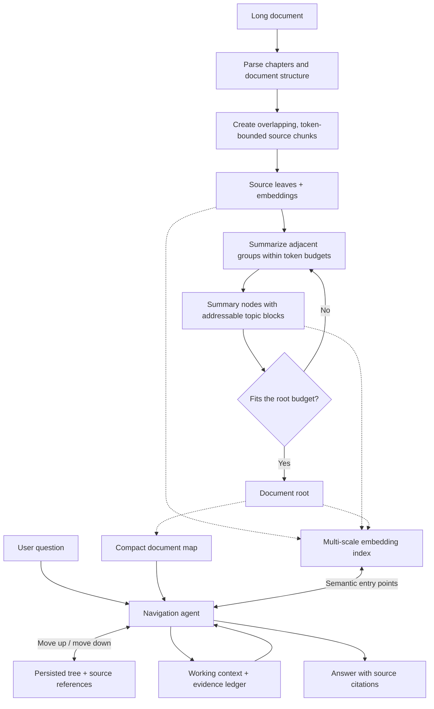

<div align="center">

# StrataWalk

### Give long context a hierarchy. Give agents a way to explore it.

Long-context exploration through order-preserving summary trees,
multi-scale semantic search, and evidence-grounded navigation.

Build bottom-up · Search across scales · Navigate with intent · Answer with evidence

[Architecture](#architecture) ·
[Agent Tools](#agent-tools) ·
[Design Principles](#design-principles) ·
[Roadmap](#roadmap)
</div>

---

> **Architecture notes.** The core design is now implemented. See
> [usage](usage.md) for runnable commands and [development](development.md)
> for precise implementation boundaries. Some goals below remain planned.

## Why StrataWalk?

Long-document questions require different reading strategies.

A precise question may need a single passage. A comparison may span several
chapters. An explanation of the document's central argument may require both
a global overview and detailed supporting evidence.

StrataWalk is designed to give an agent access to all of these scales.

It builds a hierarchy from source passages to chapter-level summaries and
document-level abstractions. The agent can enter this hierarchy through semantic
search or a compact document map, move toward broader context or finer detail,
and assemble evidence within a bounded working context.

The goal is to make a long document navigable at the level each question needs.

## The Core Idea

StrataWalk combines three mechanisms:

- Ordered recursive abstraction: summarize adjacent document regions
  bottom-up while preserving their source order.
- Multi-scale semantic search: embed source passages and summary blocks,
  allowing retrieval to begin at different abstraction levels.
- Agent-directed navigation: let the agent decide where to start,
  which branches to explore, when to recover broader context, and when
  the evidence supports an answer.

The resulting tree acts as persistent document memory. A tool-driven agent
maintains a smaller working context while exploring that memory.

## Scope and Assumptions

The method applies to long text that can be segmented into meaningful regions,
organized in a useful order, and revisited through stable source references.
Document chapters are the initial implementation of these regions. A transcript
could use sessions or time ranges; a trace could use execution stages. The
hierarchy is an access structure outside the model's native context window.

The current `IndexBuilder.build(text, source_name)` creates one static text
snapshot. A custom `SectionParser` may provide a different segmentation while
preserving contiguous, complete character spans. Other text formats can be
serialized by a caller, but serialization alone does not supply domain semantics.

| Workload | Additional design needed |
| --- | --- |
| Conversation memory | Speaker/time/turn metadata, session boundaries, changed preferences, superseded facts |
| Streaming or evolving sources | Stable identities across versions, append/update policy, ancestor and embedding invalidation |
| Multiple sources | Per-source references, corpus routing, cross-source relationships |
| Code or graph-shaped material | Syntax-aware regions, symbol/dependency links, exact analysis tools |
| Exhaustive or lossless tasks | Direct source scans or deterministic computation rather than relying on summaries |

Recursive summaries can omit details or distort qualifications. Source order
provides a structural backbone, not a guarantee of semantic completeness.
Search across branches can recover some cross-cutting evidence; a tree does
not encode every relationship. The broader long-context applicability is a
design hypothesis requiring workload-specific evaluation.

## Architecture



### 1. Establish Source Structure

The default standalone Markdown parser uses H2 sections when present, otherwise
H1; plain text becomes one section. LlamaIndex Markdown parsing is optional.
Custom parsers must preserve exact source spans. Empty, overlapping, incomplete,
or out-of-order section lists fail before model work starts.

Within each section, create overlapping source chunks that fit the configured
embedding model's input budget. Defaults are 768 counter units per chunk,
96 units of overlap, and a 1,024-unit embedding limit. The default counter uses
UTF-8 bytes; a provider-specific tokenizer is needed for calibrated token budgets.

When reliable chapter boundaries are unavailable, use a documented fallback
segmentation policy.

Each source leaf retains:

- Its original text.
- Its document and section identifiers.
- Its position in the original document.
- Exact character offsets; native page references require a future format adapter.
- Its embedding and parent reference.

Source text remains available throughout the hierarchy.

### 2. Build the Tree Bottom-Up

Group adjacent source chunks within a summarization token budget.

For each group, an LLM generates a parent node containing a bounded set of
summary paragraphs or topic blocks. These blocks are embedded individually
and retain references to their supporting children.

Repeat this process within chapters, then across adjacent chapter
representations, until the document fits a configured root budget.

```text
Document root [overview block, major-theme block, ...]
├── Chapters 1–2 summary
│   ├── Chapter 1 summary
│   │   ├── Passage-group summary
│   │   │   ├── Source chunk 001
│   │   │   └── Source chunk 002
│   │   └── Passage-group summary
│   │       ├── Source chunk 003
│   │       └── Source chunk 004
│   └── Chapter 2 summary
│       └── ...
│
└── Chapters 3–4 summary
    └── ...
```

Illustrative hierarchy; the number of levels depends on document length
and configured budgets.

Grouping follows source order regardless of model completion order. The summary
prompt requests first-occurrence order for topics. Each output block records
all immediate child blocks supplied to that reduction call. These references
are input-group provenance, not model-verified alignment of individual claims.

A long chapter may require several reduction rounds before producing its
chapter-level representation.

#### Nodes and blocks

A node is a structural container with parent–child links and a source span.

A block is an addressable unit of text inside a node, such as a summary
paragraph or topic. Each block can have its own embedding and supporting
child references.

A search result therefore identifies both a node and the specific block
that matched the query.

This lets the agent retrieve a focused topic while retaining access to
its structural context and underlying evidence.

#### Token-aware reduction

Each summarization request must satisfy:

prompt tokens
+ input block tokens
+ reserved output tokens
+ safety margin
≤ summarizer context limit

Reduction must also produce a smaller representation. Bounded output budgets
and a minimum reduction policy prevent repeated summarization from stalling.

The root may contain several blocks; it does not need to collapse into
one paragraph.

### 3. Let the Agent Navigate

At query time, provide the agent with:

- The user's question (conversation context must be supplied by the caller).
- A chapter-to-root directory.
- Navigation and search tools.
- A bounded working context and an evidence ledger.

By default, the system message contains every chapter and ancestor node with
all topic text, deduplicated. These nodes already count as read. Full mode fails
if that directory cannot fit the policy request. Explicit `directory_mode="budgeted"`
with a positive `map_budget` includes higher abstractions first and reports
omissions; navigation and search can load additional regions. A small root does
not imply a small full directory: chapter contributions grow with chapter count.

The agent then:

1. Interprets the question and identifies subquestions where useful.
2. Selects one or more entry points through the map or semantic search.
3. Reads the available information and identifies evidence gaps.
4. Moves upward for broader context or downward for finer detail.
5. Explores independent branches concurrently where useful.
6. Compacts working context while preserving evidence references.
7. Produces an answer supported by source passages, or explains the
   remaining uncertainty.

The traversal policy adapts to the question. It can begin at the root,
a chapter summary, an intermediate topic, or a source leaf.

## Agent Tools

These tools are implemented as model-selected JSON actions.
The current JSON action interfaces are described in [development notes](development.md).

| Tool | Purpose | Expected behavior |
|---|---|---|
| search | Find semantic entry points | Search source and summary blocks; return text, node IDs, block IDs, levels, scores, and source spans. |
| move_up | Recover broader context | Load parent summaries and their structural metadata. |
| move_down | Inspect supporting detail | List or load selected children, with pagination and token limits. |
| compact_context | Maintain a bounded working context | Retain bounded model-written notes and restore selected cached nodes; evidence references remain outside the active prompt. |
| finish | End the exploration | Validate citation IDs and answer scope; return an answer or explicit insufficient status. |

Navigation tools accept batches of node IDs. One coordinating agent can issue
independent read actions concurrently, sharing a per-question visited set and
cache. This is concurrent tool execution; separate reasoning agents are not spawned.

search remains available throughout exploration, allowing the agent to
recover from an unproductive branch or locate another relevant region.

### Context Management

StrataWalk separates persistent document memory from query-specific working
memory.

| Memory | Contents |
|---|---|
| Document memory | Source text, summary blocks, embeddings, tree links, and provenance. |
| Working memory | Current passages, subquestions, candidate branches, and recent tool results. |
| Evidence ledger | Read source blocks with source spans and identities; a separate ledger retains read summary blocks. |

Context compaction reduces the active workspace while retaining references
needed to reload evidence.

The runtime reserves output space and a safety margin, and fits complete recent
observations and selected source evidence into each request. The policy chooses
when to call compaction. Working notes are hypotheses, not verified facts.
The directory is always part of the prompt; full mode never silently truncates it.
The persistent tree, session cache, ledger, and trace remain in host memory;
the model's working context is bounded, but host memory is not fixed-size.

### Stopping Conditions

Exploration is bounded by policy turns (`max_steps`), parallel actions, serialized
prompt/tool-response budgets, and HTTP timeouts/retries. A global wall-clock or
cost budget is not yet implemented. Coroutines cancelled during blocking HTTP
I/O may leave an already-running worker request to finish.

The agent should finish when the evidence adequately supports the answer,
or when further exploration is unlikely to resolve a remaining gap within
the available budget.

Session state deduplicates node reads and evidence by block ID; repeated action
signatures are bounded. Overlapping leaves can still contain the same passage,
so node deduplication does not establish independent evidence.

`finish` checks that citation IDs were read or supplied in the directory.
Source scope requires at least one source-leaf citation. Explicit overview scope
may cite summaries alone. These checks do not establish entailment, completeness,
or coverage of every claim in an answer; those require semantic evaluation.

## Design Principles

### Preserve document order

Build higher-level representations from adjacent regions so the hierarchy
retains the progression of the source document.

### Make every scale searchable

Embed source passages and summary blocks. A question about a broad theme
should be able to enter at a different level from a question about a
specific figure.

### Keep abstractions connected to evidence

Summary blocks retain supporting child references. The agent can descend
from an overview to the passages needed to verify a claim.

### Use summaries for orientation

Recursive summaries are lossy. They help the agent locate relevant regions;
specific claims, numbers, and quotations should be checked against source text.

### Keep the agent's workspace bounded

The document index persists outside the model context. The agent loads
relevant regions progressively and maintains a compact evidence ledger.

### Expose the retrieval process

Record visited node IDs, tool actions, source references, and resource usage
so retrieval behavior can be inspected and evaluated.

## Indexing Efficiency

The construction pipeline is designed around parallel work:

- Batch embeddings across source passages and summary blocks.
- Summarize independent groups concurrently.
- Process independent chapters in parallel.
- Schedule parent tasks as soon as their children are ready.
- Cache completed artifacts to support resumable construction (planned).

Parent–child dependencies still constrain execution. A parent cannot be
summarized before its children exist.

For a roughly balanced tree with a stable reduction factor, the number
of levels grows logarithmically with the number of source chunks.
Actual latency and cost depend on token volume, generation length,
model throughput, concurrency limits, and tree shape.

Indexing speed and retrieval quality remain evaluation targets.
No performance advantage is claimed before reproducible measurements.

## Relationship to Existing Work

StrataWalk draws on hierarchical retrieval and agentic document navigation.

- [PageIndex](https://github.com/VectifyAI/PageIndex) demonstrates
  reasoning-based retrieval over document trees and emphasizes vectorless
  navigation. StrataWalk's proposed design combines explicit tree navigation
  with embeddings at multiple abstraction levels.
- [RAPTOR](https://arxiv.org/abs/2401.18059) introduces recursive embedding,
  clustering, and summarization for tree-organized retrieval. StrataWalk
  focuses on source-ordered reduction and a tool-driven navigation loop
  with explicit working-context management.

The intended contribution is the integration of ordered abstraction,
multi-scale entry points, evidence-linked traversal, and bounded agent memory.

## Evaluation Plan

Evaluation should cover both answer quality and the resources required
to obtain it.

| Area | Planned measurements |
|---|---|
| Index construction | Wall-clock time, input/output tokens, cost, tree depth, and storage. |
| Retrieval | Evidence recall, source coverage, redundant retrieval, and tool calls. |
| Answer quality | Correctness, citation accuracy, completeness, and unsupported claims. |
| Agent execution | Latency, peak context usage, token cost, and budget exhaustion. |
| Summary fidelity | Preservation of entities, numbers, qualifications, and conflicting claims. |

Planned comparisons include flat vector retrieval, recursive-summary retrieval,
tree navigation, and full-document prompting where the document fits.

Ablations should test:

- Source-only embeddings versus embeddings at all levels.
- Map-only entry versus semantic entry versus their combination.
- Navigation with and without upward moves.
- Context compaction with and without an evidence ledger.
- Different grouping budgets, overlap settings, and reduction factors.

## Roadmap

- [x] Define node, block, provenance, and storage schemas.
- [x] Implement section parsing and token-aware source chunking.
- [x] Implement ordered recursive reduction with bounded outputs.
- [x] Add embeddings for source and summary blocks.
- [x] Add persistent tree links and source-span lookup.
- [x] Implement search and batched navigation tools.
- [x] Add context compaction and an evidence ledger.
- [x] Add cited answers with reference and answer-scope checks.
- [x] Add bounded concurrency and transient HTTP retries.
- [x] Publish an offline end-to-end example.
- [ ] Add caching and resumable indexing.
- [ ] Publish live-model evaluation and reproducible benchmarks.

## Current Availability

A first implementation and offline example are available. See [usage](usage.md).
Real-provider quality and live Agent behavior have not yet been benchmarked.

## Contributing

Feedback on the architecture, evaluation methodology, and agent tool
design is welcome.

Particularly useful contributions include difficult long-document questions,
examples where recursive summaries lose important evidence, and workloads
that require reasoning across distant sections.

Please describe the source material, expected evidence, and the failure
mode when proposing an evaluation case.

## Author

Created by zhipuch.

---

From passages to perspective. From perspective back to evidence.
